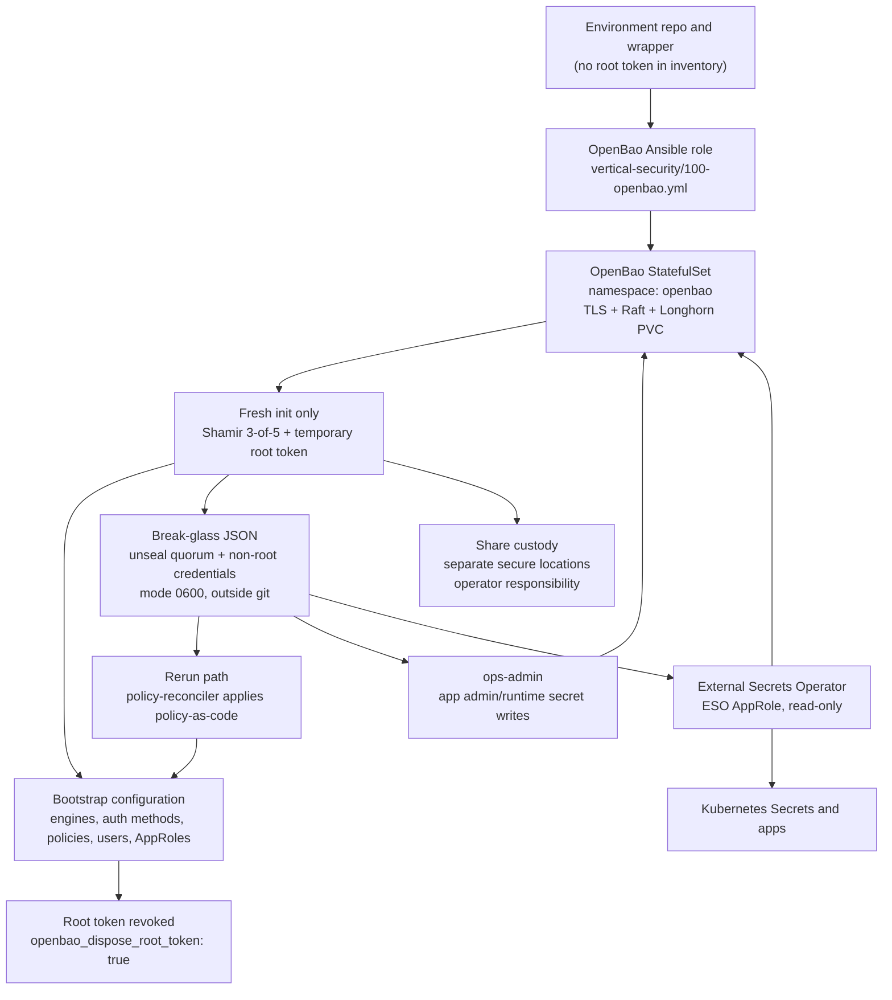

# OpenBao Bootstrap And Security Model

## Executive Summary

OpenBao is the lab's secrets control plane. The bootstrap process creates it as
an internal Kubernetes service, initializes it with Shamir key shares, configures
auth methods, policies, and automation identities, then revokes the initial root
token. After the first bootstrap, normal playbook reruns should not need root.

The security model is based on separation of duties:

- The root token is a first-bootstrap instrument only. It is not a durable
  environment value and should not be committed, copied into inventory, or used
  for routine operations.
- `policy-reconciler` can reapply ACL policy-as-code on reruns, but cannot read
  application secrets or create AppRoles.
- `ops-admin` can read and write the application admin/runtime paths needed by
  the platform, but cannot rewrite ACL policies or create AppRoles.
- `approle-reconciler` can create and manage `object-storage-*` AppRoles and
  their ESO binding records, but cannot write ACL policies or read application
  secret data. Bootstrap-only identity (ADR-0021).
- ESO uses an AppRole with read-only access to the selected secret paths it must
  materialize into Kubernetes Secrets.
- Break-glass access is preserved by protecting the OpenBao data volume, a
  quorum of Shamir key shares, and the local break-glass automation JSON.

This means a secure bootstrap does not preserve power by keeping root around.
It preserves power by keeping recoverability around: the encrypted OpenBao state,
enough unseal/recovery material, and narrowly scoped operational credentials.

## Process Diagram



## Bootstrap Flow

1. The environment wrapper exports runtime variables and runs
   `vertical-security/100-openbao.yml` against the target cluster. The generic
   repo keeps using variables such as `openbao_key_path`, but it must not contain
   real secrets or environment-specific addresses.

2. The role deploys OpenBao in the `openbao` namespace as an internal service on
   port `8200`, using TLS, Raft storage, and the configured Kubernetes storage
   class. The default storage class is Longhorn.

3. The role reads the existing break-glass JSON from
   `{{ openbao_key_path }}.json`, if it exists. This is the rerun state file. It
   contains unseal keys and non-root automation credentials, not a root token.

4. The role checks whether OpenBao is already initialized:

   - If not initialized, it performs a Shamir init with the configured share
     count and threshold. The current default is `3-of-5`.
   - If already initialized, it loads the unseal material and operational
     credentials from the existing break-glass JSON.

5. On a fresh init, the temporary root token is used only long enough to:

   - unseal OpenBao;
   - enable required engines such as AppRole, Kubernetes auth, userpass, PKI, and
     KV v2;
   - write the ACL policies;
   - create the ESO and born-inventory AppRoles;
   - create `ops-admin`;
   - create `policy-reconciler`;
   - create `approle-reconciler`;
   - write the break-glass JSON.

6. On a rerun, the role logs in as `policy-reconciler` and uses that token to
   reapply ACL policies. This allows policy drift to be repaired without keeping
   or reintroducing the root token.

7. The role logs in as `ops-admin` and verifies that it has the required
   capabilities on representative application paths, including the Zot admin
   path. This catches policy drift before later playbooks depend on those paths.

8. If `openbao_dispose_root_token` is true, the initial root token is revoked at
   the end of a fresh bootstrap. This is the intended steady state.

## Initial Bootstrap Preconditions

Before a brand-new bootstrap, confirm these are true:

- The environment wrapper can reach the target control node and kubeconfig.
- Longhorn or the selected storage class is ready before OpenBao needs its PVC.
- TLS/certificate prerequisites are available for the OpenBao internal service.
- `openbao_key_path` points to a secure writable location outside git.
- Any configured custody targets for Shamir shares are mounted and writable.
- The operator has a deliberate backup/custody plan before `bao operator init`
  runs.

Do not bypass share-custody prechecks by writing recovery material into the
repository, into chat transcripts, or into ad hoc temporary locations. If a
custody target is unavailable, stop and fix custody first.

## Why This Bootstrap Is Secure

The bootstrap is secure because it removes standing root access while preserving
recoverability:

- The only full-power credential, the root token, exists only during first
  bootstrap and is revoked afterward.
- Policy repair has its own identity, `policy-reconciler`, scoped to ACL policy
  management rather than secret reads.
- Application secret management has a separate identity, `ops-admin`, scoped to
  the app admin/runtime paths needed by the platform.
- ESO receives only read access to the selected secret paths it must materialize
  into Kubernetes.
- Sensitive OpenBao CLI calls pass credentials into the pod through stdin, with
  Ansible `no_log: true`, instead of exposing them as process arguments.
- OpenBao is served internally with TLS and backed by persistent storage.
- Recovery depends on share quorum and controlled break-glass custody, not on a
  durable root token.
- Generic playbooks remain secret-free; environment-specific values stay in the
  private environment repo or protected local custody locations.

## Security Model

### Root Token

The root token is the most powerful credential OpenBao creates. In this design,
it is treated as disposable bootstrap material:

- It is generated only by `bao operator init`.
- It is used only during first initialization.
- It is not saved into the environment repository.
- It is not required for normal reruns.
- It is revoked once bootstrap has completed.

Do not add an initial or root token to inventory, env files, group vars, CI
variables, or long-lived shell profiles. That would weaken the design by turning
a one-time bootstrap credential into a standing administrative credential.

### Shamir Shares

OpenBao is initialized with Shamir key shares. The default model is `3-of-5`:
five shares exist, and any three can unseal the system or participate in
privileged recovery ceremonies.

These shares are the durable root of recovery. The operator must keep at least a
threshold quorum readable, protected, and separated. Losing quorum means losing
the practical ability to regain privileged access if the normal automation
identities are broken.

### High Availability And Restarts

Long-lived sites run OpenBao as a Raft cluster of three pods. Set
`openbao_replicas: 3` in the site inventory. The default is `1`, which the
sandbox lane keeps. A single pod has no peer to take over, so OpenBao is offline
from the moment that pod restarts until someone unseals it.

Use `1` or at least `3`. A Raft cluster of two pods cannot lose a pod, so the
role refuses `2` before it changes anything. The grow play is narrower: it
supports exactly `3` replicas.

A cluster keeps OpenBao serving while one pod restarts. It does not remove the
unseal. The seal is Shamir, so every restarted pod comes back sealed and needs
the threshold of shares before the next pod restarts. A rolling upgrade is a
sequence of restarts, and each one ends with an unseal.

How the cluster is built:

- A StatefulSet of `openbao_replicas` pods. Its update strategy is `OnDelete`,
  so Kubernetes never restarts a pod on its own. Each restart is a step you run.
- A headless Service (`openbao-internal`) gives each pod a stable name. Each pod
  advertises that name and joins its peers with `retry_join` over TLS. The
  `openbao` Service stays the address that clients use.
- The certificate that every pod serves covers the headless Service and the pod
  names under it (`*.openbao-internal.openbao.svc.cluster.local`). The CA that
  signed it (`ca.crt` in the same Secret) is the trust anchor for `retry_join`.
- A pod is ready only when it is initialized and unsealed. A sealed pod leaves
  the `openbao` Service, and it counts against the PodDisruptionBudget
  (`maxUnavailable: 1`), so a node drain waits while a pod is sealed.
- Pod anti-affinity prefers separate nodes. It requires them when the cluster
  has at least as many nodes as pods.
- Init runs on pod 0 only. The role then unseals every pod with the threshold of
  shares, sent on stdin.

To restart pods, for an upgrade or a node drain, restart one pod at a time:

1. Run `vertical-security/102-openbao-ha-guard.yml`. It refuses while any pod is
   sealed or not a healthy Raft voter.
2. Run `vertical-security/103-openbao-restart-pod.yml -e openbao_restart_pod_name=openbao-2`.
   It runs the same guard, restarts that one pod, and stops.
3. Unseal the restarted pod with the threshold of shares, for example with
   `OPENBAO_POD=openbao-2 bin/unseal-openbao.sh <env>` from `dmf-env`.
4. Repeat from step 1 for the next pod. Restart the standby pods first and the
   pod that leads last.

The guard reads each pod with `bao status`. On a cluster it also reads the Raft
state from Autopilot (`bao read sys/storage/raft/autopilot/state`). It refuses unless
every expected pod, matched by its Raft node ID, is a voter that Autopilot reports
as healthy with a recent last contact, is at its per-pod Raft address
(`<pod>.openbao-internal.openbao.svc.cluster.local:8201`), Autopilot reports the
cluster healthy, and the cluster can lose one more voter (a failure tolerance of at
least 1). A single-replica install stores node 1 at the Service address, and
OpenBao does not rewrite it when pod 0 restarts. A leader then dials a random pod
for that peer and steps down, so the guard names the address and refuses. A pod
that is unsealed and answers locally is not enough: a follower cut off from its
peers still looks that way. If the state cannot be read, the guard refuses.

The read needs an `ops-admin` token, which you give to the play in
`OPENBAO_GUARD_TOKEN`. The `app-admin-writer` policy of `ops-admin` grants it two
reads, on `sys/storage/raft/autopilot/state` and `sys/storage/raft/configuration`.
Nothing skips the guard on a cluster: `openbao_guard_require_peers` can be `false`
only when `openbao_replicas` is 1. To look at the seal state alone, run
`bin/unseal-openbao.sh <env> --status-all`. A single replica has no peers, so the
guard passes when that pod is unsealed.

Pod 0 keeps the node ID `1` that a single-replica install stores. The other pods
use their pod name as their node ID.

`bin/upgrade-in-place.sh` in `dmf-env` runs this guard in its stage 1b, after it
checks that every pod is unsealed and before any stage that can restart a pod. The
`--skip-unseal-check` flag of that script skips only the seal check of stage 1, not
the guard.

Run the guard before a node drain or reboot as well. The unattended-upgrades
reboot schedule in `k3s-lab-bootstrap/docs/hardening.md` does not run it.

#### Grow A Single Replica To A Raft Cluster

`vertical-security/104-openbao-grow-ha.yml` grows an installed single-replica
site. It keeps the data and the existing shares and never runs `bao operator
init`. It is a live change: pod 0 restarts and stays sealed until the play
unseals it. Rehearse it on a disposable environment first, and get the operator's
approval before you run it on an installed one. The play supports exactly three
replicas. It does not support `--check`: it refuses at its first task, before it
reads or changes anything.

1. With `openbao_replicas` still `1`, run `vertical-security/100-openbao.yml`. It
   reconciles the `app-admin-writer` policy, so `ops-admin` gets the two Raft
   reads. Take an `ops-admin` token for `OPENBAO_GUARD_TOKEN`.
2. Set `openbao_replicas: 3` in the site inventory. The play refuses any other
   count.
3. Run the play with `OPENBAO_GUARD_TOKEN` set. Before it changes anything, it
   checks that the replica count is 3, that the existing pod is initialized,
   unsealed and active, and that the token can read both Raft paths. It then reads
   the metadata of the paths in `openbao_migration_read_paths` (version and update
   time, never a value). It fails if the list is empty, if a read fails for any
   reason other than a confirmed "not found", or if no path reads successfully, and
   it checks that before its first change, so a site with nothing to compare finds
   out before the outage.

   The play then reissues the OpenBao certificate with the Raft peer names, from
   the cert-manager role's Certificate definition, and waits until the TLS secret
   holds a certificate that covers `*.openbao-internal.openbao.svc.cluster.local`.
   It recreates the StatefulSet in the Raft shape without deleting the pod or the
   volume. It writes `raft/peers.json` into the data directory of pod 0, so that
   node 1 is stored at `openbao-0.openbao-internal.openbao.svc.cluster.local:8201`
   and not at the Service address. It restarts pod 0 and unseals it. It then
   reads `sys/storage/raft/configuration` and refuses to scale unless node 1 is at
   that address. It scales to three pods, unseals the new pods, and waits for every
   pod to be a healthy voter (up to `openbao_guard_wait_timeout_seconds`, checking
   every `openbao_guard_wait_interval_seconds`, because Autopilot promotes a new
   server after a stabilization period). It then reads the same paths again and
   fails when they differ.
4. Run the ESO play (`vertical-orchestration/100-eso.yml`) right after the play.
   The CA signs the reissued certificate, so a site that already uses the CA
   keeps its trust. A site that still runs the older self-signed certificate must
   first move to the CA (see "Move An Existing Environment To The CA").
5. Prove the recovery shares. Restart one standby pod with
   `103-openbao-restart-pod.yml` and unseal it with the recovery shares.

The play has no automatic resume. It runs only from a single-replica install, and
every check that can refuse runs before its first change. Once it changes the
StatefulSet, it refuses to run again, because the StatefulSet is no longer a
single replica. If it stops after the certificate reissue and before the
StatefulSet change, the install is still single-replica, and you can run the play
again after the first repair in the next section.

#### Recover An Interrupted Migration

This section covers a grow to three replicas, the only size that the play
supports. If the play stops, find the stop point, then follow the steps for it.
For every stop point, start with `bin/unseal-openbao.sh <env> --status-all`, which
shows each pod and whether it is sealed. To see the Raft peers, run `bao operator
raft list-peers` in a pod that is unsealed, with an `ops-admin` token. If every
`bao` call in pod 0 fails with an `x509` error, the reissued certificate is in
place and pod 0 still serves the old one, because the reload in the certificate
task file did not finish. Skip the peer check and follow step 1: a restart of pod 0
clears the error.

Node 1 is at the wrong address when `list-peers` shows it at
`openbao.openbao.svc.cluster.local:8201` (the Service). It must be at
`openbao-0.openbao-internal.openbao.svc.cluster.local:8201`. To fix it, give pod 0
a `peers.json` file that holds the right address. OpenBao reads the file when pod 0
starts and removes it:

```json
[{"id": "1", "address": "openbao-0.openbao-internal.openbao.svc.cluster.local:8201", "non_voter": false}]
```

Send the file to pod 0 on stdin:
`kubectl -n openbao exec -i openbao-0 -- sh -c 'cat > /openbao/data/raft/peers.json'`.
Then delete the pod with `kubectl -n openbao delete pod openbao-0`, wait for the
StatefulSet to recreate it, and unseal it.

The stop points are in the order that the play reaches them:

1. **The certificate has the peer names, and the StatefulSet is still the
   single-replica one.** The play stopped after it reissued the certificate and
   before it deleted the StatefulSet. If the reload in the certificate task file
   did not finish, pod 0 still serves the old certificate, so the `bao` CLI in the
   pod fails with an `x509` error, and a new run of the play fails its own status
   check. Repair it:
   1. Delete pod 0 with `kubectl -n openbao delete pod openbao-0`, so that it
      loads the new certificate. Wait for the StatefulSet to recreate it.
   2. Unseal it with `OPENBAO_POD=openbao-0 bin/unseal-openbao.sh <env>`.
   3. Run the ESO play, `vertical-orchestration/100-eso.yml`. It reads the
      CA certificate from the CA's own Secret and sets it as the `caBundle` of
      the `ClusterSecretStore`, so ESO trusts the CA that signed the certificate.
   4. Run `vertical-security/104-openbao-grow-ha.yml` again. It finishes the
      migration, so you do not need the later steps. Run the ESO play again when
      it ends, as the play says.

   This branch has not been rehearsed end to end. A rehearsal observed the TLS
   failure, and that a restart of pod 0 followed by an unseal clears it.
2. **The StatefulSet is missing.** No play recreates it at one replica today. Stop
   and ask for help before you change anything.
3. **The StatefulSet is in the Raft shape at one replica, and pod 0 has not
   restarted.** The governing Service is `openbao-internal`, and there is one
   pod. Write `peers.json` as above, delete pod 0, wait for the new pod, and unseal
   it with `OPENBAO_POD=openbao-0 bin/unseal-openbao.sh <env>`. Then go to step 7.
4. **Pod 0 restarted and is sealed.** Unseal it with
   `OPENBAO_POD=openbao-0 bin/unseal-openbao.sh <env>`. Then follow step 5.
5. **Pod 0 is unsealed and node 1 is at the wrong address.** The StatefulSet is
   in the Raft shape at one replica, and pod 0 has restarted, is unsealed and
   leads. The play stopped before it scaled, with "Raft node 1 is at ... not at
   ..." or with a note that it could not read the address. Whichever message you
   saw, follow these steps:
   1. Run `list-peers` and read the address of node 1.
   2. If node 1 is at the Service address, write `peers.json` as above, delete pod
      0, and unseal it with `OPENBAO_POD=openbao-0 bin/unseal-openbao.sh <env>`.
   3. Run `list-peers` again. Go to step 7 only when node 1 is at exactly
      `openbao-0.openbao-internal.openbao.svc.cluster.local:8201` (with the
      default headless Service name and namespace).
   4. If `list-peers` fails, or shows any other address for node 1, stop. Do not
      scale. Ask for help, and include the output of `list-peers` and of
      `--status-all`.

   Do not run the play again: it refuses, because the StatefulSet is no longer a
   single replica.
6. **The StatefulSet is scaled and the pods are sealed.** Unseal each sealed pod
   with `OPENBAO_POD=<pod> bin/unseal-openbao.sh <env>`, one at a time. Then run
   `list-peers`. If node 1 is at the Service address, write the same file, with
   all three peers, to every pod, then delete all three pods and unseal them:

   ```json
   [
     {"id": "1", "address": "openbao-0.openbao-internal.openbao.svc.cluster.local:8201", "non_voter": false},
     {"id": "openbao-1", "address": "openbao-1.openbao-internal.openbao.svc.cluster.local:8201", "non_voter": false},
     {"id": "openbao-2", "address": "openbao-2.openbao-internal.openbao.svc.cluster.local:8201", "non_voter": false}
   ]
   ```

   OpenBao is offline until the threshold of pods is unsealed. Then go to step 8.

These steps finish a recovery that began at step 3, 4 or 5. A recovery that began
at step 6 continues at step 8.

7. Scale the StatefulSet to three pods:
   `kubectl -n openbao scale statefulset openbao --replicas=3`. Unseal each new
   pod with `OPENBAO_POD=<pod> bin/unseal-openbao.sh <env>`.
8. Run `vertical-security/102-openbao-ha-guard.yml` with `OPENBAO_GUARD_TOKEN` set,
   and repeat until it passes. Autopilot promotes a new server a short time after
   it joins, so the guard can refuse for a minute or two. If it refuses with a Raft
   address, the message names the server by pod name and node ID. During a grow,
   only node 1 can carry the Service address, because the other pods join with
   their per-pod address. If the message names node 1, follow the three-peer
   repair in step 6. If it names another server, stop and do not apply the node 1
   repair.
9. Run `vertical-security/105-openbao-verify-ha.yml`. It checks that every pod is a
   healthy voter and reads the metadata of the paths in
   `openbao_migration_read_paths`. It has no earlier read to compare with, so
   compare the versions it prints with the "before" read in the output of the
   migration run.
10. Run the ESO play (`vertical-orchestration/100-eso.yml`) if the play stopped
    before it, so the `ClusterSecretStore` trusts the reissued certificate.

The play unseals with the automation file, as the role does on every rerun. Step
5 of "Grow A Single Replica To A Raft Cluster" is the check that the ADR-0009
shares still work after the migration.

### Certificate Authority For OpenBao TLS

OpenBao serves a certificate that a CA in the `openbao` namespace signs. The
cert-manager role creates a self-signed bootstrap Issuer (`openbao-selfsigned`),
a root Certificate (`openbao-ca`, ten years, renewed a year early, Secret
`openbao-ca-tls`), and a CA Issuer (`openbao-ca`) that signs the `openbao`
Certificate. The `openbao-tls` Secret keeps its name and holds `ca.crt` beside
`tls.crt` and `tls.key`.

Each client trusts a CA certificate, never the OpenBao certificate:

- The pods use `ca.crt` from the `openbao-tls` Secret, mounted in the pod, for
  `BAO_CACERT` and for `leader_ca_cert_file` of `retry_join`.
- The ClusterSecretStores that the ESO and object-storage-credentials roles
  create use the certificate in the CA's own Secret (`openbao-ca-tls`), after a
  wait that proves the CA Certificate is Ready for its current generation. They
  do not read the `openbao-tls` Secret. When the cluster has no OpenBao CA
  Certificate yet, both roles stop and say to run `320-cert-manager.yml` first.
  A site that points a store at an endpoint with other trust sets
  `eso_openbao_external_trust` (the main store, which then uses
  `eso_openbao_ca_bundle` if it is set) or
  `object_storage_eso_openbao_external_trust` (the per-class stores, which then
  carry no bundle). To move an existing store from the CA to external trust,
  delete the store first: a merge keeps the bundle that it already holds.

A renewal of the OpenBao certificate changes nothing that a client trusts. The
root Certificate keeps its private key when it renews (`rotationPolicy: Never`),
so a renewed root has the same subject and key. Leaves signed before the renewal
and bundles that hold the old root keep verifying until the old root expires.
cert-manager does not reissue leaves when the root renews, so after a renewal
of the root the OpenBao certificate keeps the `ca.crt` of the root that signed it
until it is reissued. The renewed root verifies that certificate (same key and
subject), so the plays keep working in the meantime. The runbook (section "Renew
the CA") gives the order of the plays before the old root expires.

What the certificate task file proves before anything uses the new certificate:
the Certificate is Ready for its current generation, the Secret names the CA
Issuer as its issuer, `tls.crt` is not the CA's certificate, and the certificate
verifies against the current certificate in the CA's Secret. A
self-signed certificate from before the move can already hold a `ca.crt` that
equals itself, so a key that is present proves nothing.

OpenBao reads its listener certificate at startup and again on `SIGHUP` (OpenBao
v2.5.2, `website/content/docs/configuration/listener/tcp.mdx`, lines 32 and
133-147). The option `tls_auto_reload` is not in v2.5.2, so the configuration
does not set it. The kubelet writes a renewed certificate into the pods within
about a minute, but a running server keeps its old certificate until it reloads.
The certificate task file runs the reload in each running pod every time it runs:
it waits until the pod holds the Secret's files, sends `SIGHUP` to the server,
and checks three things. A TLS client on the node connects to the pod's own
address (the pod IP and port 8200) and compares the certificate it receives with
the projected certificate. A client that holds the projected `ca.crt` verifies the
certificate the server serves, and the pod's own CLI works. The comparison is the
one that proves the reload: a renewed certificate and the one before it verify
against the same CA. A renewal therefore reaches
the servers the next time `320-cert-manager.yml` runs, and the old certificate
stays valid for the days that remain after the renewal. Pods that run on the CA
trust `ca.crt`, so a renewal does not break their CLI in the meantime.

#### Move An Existing Environment To The CA

An environment that runs the older self-signed certificate moves in four plays:
the certificate play (`320-cert-manager.yml`), the ESO play, the object-storage
play and the OpenBao play, followed by a pod-by-pod restart on a Raft cluster.
The order matters, and a pod that restarts comes back sealed. For the steps, the
checks and the recovery, follow the umbrella runbook
[OpenBao Listener Certificate](https://github.com/dmfdeploy/dmfdeploy/blob/main/docs/runbooks/openbao-listener-certificate.md).

Until a pod reloads, its CLI can fail with an `x509` error, because the old pods
name the certificate file as their trust (`BAO_CACERT` points at `tls.crt`) and
that file holds the new certificate once the kubelet projects it. The certificate
task file does not use the CLI before the reload. The stores stay not ready from
the reload until the ESO and object-storage plays finish, because they still hold
the old self-signed certificate. A fresh bootstrap needs no extra step.

### Break-Glass JSON

The file at `{{ openbao_key_path }}.json` is the automation break-glass file. It
is written with mode `0600` and must live outside git. It contains data needed
for unattended or semi-attended operations, including:

- unseal key material used by automation;
- ESO AppRole `role_id` and `secret_id`;
- born-inventory AppRole credentials;
- `ops-admin` username and password;
- `policy-reconciler` username and password;
- Shamir threshold metadata.

It intentionally does not preserve the root token. Treat this file as highly
sensitive. A copy of it can usually restore operational automation, but it
should still be protected like a privileged secret bundle.

### Policy-Reconciler

`policy-reconciler` is a userpass identity with the `policy-writer` policy. Its
job is narrow: reapply policy-as-code on initialized clusters. The policy grants
access to `sys/policies/acl/*`, allowing it to create, read, update, delete, and
list ACL policies.

It should not be used for application secret reads or writes. If this password
is lost on an already initialized cluster, policy repair cannot proceed through
the normal rerun path; use a privileged recovery procedure or rebuild.

### Ops-Admin

`ops-admin` is the operational identity used by app bootstrap and integration
roles. It receives the app admin/runtime writer policies. It can manage paths
such as:

- `secret/data/apps/+/admin`
- `secret/metadata/apps/+/admin`
- `secret/data/apps/+/runtime`
- `secret/metadata/apps/+/runtime`
- selected bootstrap paths such as Authentik passkey material

`ops-admin` should not have broad ACL policy-write privileges. That separation
is deliberate: an app-secret operator should not also be able to rewrite the
rules governing every other identity.

### AppRole-Reconciler

`approle-reconciler` is a bootstrap-only identity with the
`approle-reconciler-writer` policy. Its scope is limited to the
`object-storage-*` AppRoles and their `secret/platform/eso-bindings/object-storage-*`
records (ADR-0021). It can:

- create, read, update, and delete `object-storage-*` AppRole definitions;
- read role-id values;
- create and read secret-id values;
- create, read, update, and delete ESO binding records.

It **cannot**:

- write ACL policies (`sys/policies/acl/*` — reserved for `policy-reconciler`);
- read application secret data (`secret/data/apps/*` — reserved for `ops-admin`);
- create AppRoles outside the `object-storage-*` prefix.

The password is generated during fresh init and persisted to the break-glass
JSON. On existing clusters without the `approle_reconciler_password` field,
the OpenBao role fails early with a clear recovery message — the operator must
run a Shamir-backed privileged recovery ceremony or rebuild.

### ESO AppRole

External Secrets Operator authenticates to OpenBao through the ESO AppRole. The
AppRole receives the `eso-reader` policy. The policy reads the application
secret paths that ESO materializes into Kubernetes Secrets, and it grants
nothing else. In particular, it grants no capability on the PKI mount. The
identity verifier checks this in both ESO auth modes. It reads the live policy
and fails if a path stanza covers the PKI mount or a capability other than
`read` and `list` appears. In AppRole mode it also reads the ESO AppRole role
and fails if the role's `token_policies` is anything other than `eso-reader`.
The verifier never logs in as ESO with AppRole and never reads or uses ESO's
`secret_id`, because a failed AppRole login counts toward the lockout of ESO's
role. In Kubernetes mode it also logs in as ESO and fails if the token holds any
capability on `pki/issue/internal-ca`.

ESO's `secret_id` has a configured TTL, currently defaulting to `720h`. Rotation
should be handled by the ESO rotation playbook, not by manually editing
Kubernetes Secrets unless performing a documented recovery.

### KV V2 Paths

OpenBao KV v2 has separate paths for values and metadata:

- `secret/data/...` is used for reading and writing secret values.
- `secret/metadata/...` is used for listing and metadata operations.

Policies must include both where workflows need both secret access and list or
metadata access. Missing metadata capability can break otherwise valid
automation.

### Credential Handling In Playbooks

Credential-bearing `kubectl exec` calls must pass secrets into the pod through
stdin and local task environment variables with `no_log: true`. They must not
place tokens or passwords in shell command arguments where they can appear in
process listings, audit logs, or Kubernetes request URIs.

This matters because the OpenBao CLI runs inside the pod. Setting `BAO_TOKEN` in
the local Ansible process is not enough unless the command explicitly passes it
into the in-pod shell.

## Vital Components

The following components are vital to preserve the security and recoverability
of the system:

| Component | Why it matters | Operator responsibility |
| --- | --- | --- |
| OpenBao StatefulSet and PVC | Holds the encrypted OpenBao state | Keep storage healthy and backed up |
| TLS secret | Protects OpenBao service traffic | Keep certificate automation working |
| Shamir share quorum | Enables unseal and privileged recovery | Preserve at least threshold shares |
| Break-glass JSON | Preserves non-root automation recovery | Keep outside git, mode `0600`, securely backed up |
| `policy-reconciler` | Repairs policy drift after root revocation | Preserve password and verify rerun works |
| `ops-admin` | Performs app secret bootstrap and runtime writes | Preserve password and rotate deliberately |
| `approle-reconciler` | Creates/manages object-storage AppRoles + ESO bindings | Preserve password; first run requires Shamir recovery on existing clusters |
| ESO AppRole | Lets ESO read approved secret paths | Rotate secret IDs and keep policies narrow |
| ACL policies | Enforce separation of duties | Manage through playbooks, not manual edits |
| Kubeconfig/control-node access | Needed to reach OpenBao pod and cluster resources | Preserve cluster admin access separately |

## What The Operator Must Preserve

To preserve ultimate access when required, the operator must take care of these
items:

1. Keep at least the Shamir threshold available. With the current default, that
   means at least three valid shares. Store shares in separate secure locations
   and periodically confirm they are readable.

2. Keep the break-glass JSON available and protected. It is not root, but it is
   powerful. It should be backed up to secure storage, excluded from git, and
   readable only by the operator account that runs the environment wrapper.

3. Keep OpenBao storage recoverable. A quorum of Shamir shares cannot recover
   secrets if the OpenBao data volume is destroyed and no usable backup exists.

4. Do not persist a root token. If a procedure appears to require a long-lived
   root token, treat that as a design exception and document the recovery
   ceremony instead.

5. Verify rerun idempotency after bootstrap. Running the OpenBao playbook twice
   should succeed: the first run proves fresh bootstrap, and the second run
   proves the non-root policy reconciliation path.

6. Rotate operational credentials deliberately. ESO AppRole secret IDs and
   `ops-admin` credentials have dedicated rotation paths. Rotation should update
   OpenBao and the break-glass file together.

7. Keep inventory clean. Environment inventory may point to the secure
   break-glass location, but it must not contain live root tokens, unseal shares,
   passwords, AppRole secret IDs, or real service credentials.

## Recovery Scenarios

| Scenario | Expected response |
| --- | --- |
| OpenBao pod restarts and is sealed | Unseal using automation or a Shamir quorum, then rerun the OpenBao playbook. In a Raft cluster, unseal the pod before you restart the next one (see High Availability And Restarts) |
| ACL policy drift breaks app roles | Rerun `vertical-security/100-openbao.yml`; `policy-reconciler` should reapply policies |
| `ops-admin` password is lost | Use a privileged recovery procedure to reset it, or rebuild if recovery material is unavailable |
| `policy-reconciler` password is lost | Use a privileged recovery procedure to restore policy-write access, or rebuild |
| `approle-reconciler` password is lost | Use a privileged recovery procedure to create the userpass user and update break-glass JSON, or rebuild. Object-storage AppRole reconciliation will fail until resolved. |
| ESO cannot read secrets | Check ESO AppRole Secret, TTL/rotation state, `eso-reader` policy (it reads the application secret paths and grants nothing on the PKI mount), and ClusterSecretStore status |
| Break-glass JSON is lost but Shamir quorum remains | Use a documented privileged recovery ceremony to recreate operational identities |
| Shamir quorum is lost | Ultimate access is not preserved; restore from separate backup or rebuild and reseed secrets |
| OpenBao PVC/data is lost | Restore OpenBao storage from backup, or rebuild and reseed all secrets |

## Normal Validation

After a fresh bootstrap, validate the model with a fresh run and a rerun:

```bash
cd ../dmf-env
bin/run-playbook.sh <env-name> ../dmf-infra/k3s-lab-bootstrap/playbooks/vertical-security/100-openbao.yml
bin/run-playbook.sh <env-name> ../dmf-infra/k3s-lab-bootstrap/playbooks/vertical-security/100-openbao.yml
bin/run-playbook.sh <env-name> ../dmf-infra/k3s-lab-bootstrap/playbooks/runbooks/eso-openbao-health-check.yml
```

The first OpenBao run should complete the bootstrap. The second run should
complete without the root token by using `policy-reconciler`. The health check
should confirm ESO/OpenBao connectivity and representative capabilities.

## Secure Steady State

The desired steady state is:

- OpenBao is initialized, unsealed, TLS-protected, and backed by persistent
  storage.
- The root token has been revoked.
- Policies are managed by playbook reruns through `policy-reconciler`.
- Application secret operations use `ops-admin`.
- ESO reads only the paths it needs.
- Break-glass material is preserved outside git and under operator control.
- At least a Shamir threshold is safely recoverable.

If all of those are true, the bootstrap is secure in the intended sense: normal
automation has only the permissions it needs, the most dangerous token is gone,
and the operator still has a controlled path to regain access when required.
